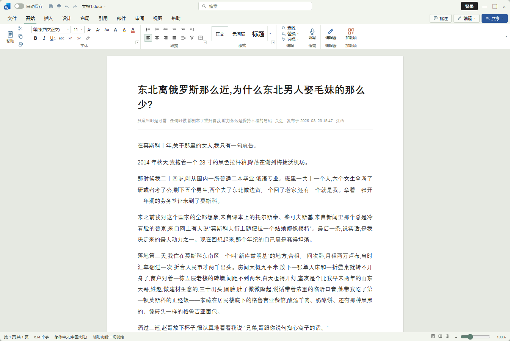

<h1 align="center">知乎 Word 文档模式</h1>

把知乎文章变成一份 Word 365 文档。

  <a href="https://greasyfork.org/zh-CN/scripts/602452"><strong>Greasy Fork 安装</strong></a>
  ·
  <a href="https://raw.githubusercontent.com/licc-pai/zhihu-word-mode/main/zhihu-word-mode.user.js">GitHub 直装</a>
  ·
  <a href="#功能">功能</a>
  ·
  <a href="#使用">使用</a>
  ·
  <a href="CONTRIBUTING.md">贡献</a>

  

## 为什么做这个

知乎的阅读页信息密度高、视觉上很容易被认出是在刷知乎。这个脚本把正文转成 Word 文档界面，适合在办公环境里低调阅读长文，也适合只想安静看文章、不想被页面其他元素打断的时候。

## 功能

- 支持知乎专栏文章、回答页和问题页。
- Word 365 风格界面：标题栏、选项卡、功能区、样式组、状态栏。
- 标题栏、选项卡、功能区和状态栏固定，只有白纸区域滚动。
- 进入文档模式后浏览器标签页标题/图标换成 Word，标题栏文件名默认「文档1.docx」，可在设置里修改；退出时自动还原。
- 文末加载评论区：优先直接请求知乎评论接口，失败回退到页面已加载评论；支持“加载更多评论”、嵌套回复、作者/时间/赞数。
- 支持字号、行距、纸张宽度、缩放、深浅主题、打印 / 保存 PDF。
- 点字体组或段落组右下角的 ◢ 打开「字体与版式」设置。
- `Alt + W` 切换文档模式，`Esc` 返回网页；已做知乎 SPA 路由变化检测。

## 安装

1. 先安装 [Tampermonkey](https://www.tampermonkey.net/)。
2. 任选一种方式安装（两者是同一份脚本，装一个就行）：
   - **Greasy Fork**：[知乎 Word 文档模式](https://greasyfork.org/zh-CN/scripts/602452)
   - **GitHub 直装**：[zhihu-word-mode.user.js](https://raw.githubusercontent.com/licc-pai/zhihu-word-mode/main/zhihu-word-mode.user.js)
3. 篡改猴弹出安装页后点“安装”。
4. 打开知乎文章或回答页，刷新，点右下角“文档模式”或按 `Alt + W`。

手动安装：打开篡改猴面板 → 添加新脚本 → 把 `zhihu-word-mode.user.js` 的全部内容粘进去 → 保存。

## 使用

- 进入/退出：右下角“文档模式”、`Alt + W`、右上角 × 或 `Esc`。
- 设置：点字体组或段落组右下角的 ◢，可调字号、行距、纸张宽度、主题、文档名、是否在文末显示评论。
- 评论：默认在正文末尾追加评论区；接口不可用时回退到页面已加载的评论。
- 打印：标题栏打印按钮或 `Ctrl/Cmd + P`；打印样式只保留文档正文。

## 隐私

- 脚本只在当前知乎页面内运行，不向第三方服务器发送内容。
- 评论区通过知乎自己的接口加载，使用当前浏览器的登录态；请求只发往 zhihu.com。
- 没有统计、埋点或远程配置。

## 兼容性

- 在 Chrome / Edge + Tampermonkey 下开发和测试。
- 知乎的用户名、评论接口等都是未公开的内部结构，知乎改版后可能失效；正文识别和评论都有兜底逻辑，但无法保证长期稳定。
- 0.3.x 只适配 Word 365 皮肤；多版本皮肤切换在路线图里。

## 已知限制

- 评论区只能拿到接口返回或页面已渲染的部分；被折叠的“查看更多回复”不会自动展开。
- 知乎评论接口可能需要登录，且可能被风控拦截；失败会回退到页面评论，并在控制台留一条 `[zhihu-word-mode]` 警告。
- 浏览器地址栏仍然是 zhihu.com，用户脚本无法修改。
- 只模拟界面外观，不是可编辑的 Word 文档，也不生成 .docx 文件。

## 开发

无需构建、无依赖，直接编辑 `zhihu-word-mode.user.js`。测试方式和提交约定见 [CONTRIBUTING.md](CONTRIBUTING.md)。

## 路线图

- [x] Word 365 皮肤
- [x] 标签页 / 文件名伪装
- [x] 文末评论（接口优先 + 页面兜底）
- [ ] 多套 Word 版本皮肤切换（2003 / 2007 / 2010 / 2013 / 2019…）
- [ ] 更多站点与展示皮肤（扩展落地时再评估仓库改名）
- [ ] 更稳的正文 / 评论选择器

## 免责声明

- 本项目与知乎、Microsoft 均无关联。
- 界面中的 Word 图标与“Word”名称为 Microsoft Corporation 的商标，仅用于界面样式模拟。
- 请遵守知乎的服务条款和所在单位的规定；脚本按“现状”提供，不保证可用性。

## License

[MIT](LICENSE)

---

**English**: A Tampermonkey userscript that renders Zhihu articles as a Word 365-style document. It fixes the Word chrome while only the page scrolls, disguises the browser tab as a Word document, and can append comments at the end of the article. Comments are loaded through Zhihu's own API first and fall back to the rendered DOM. Built with vanilla JavaScript, no build step, no third-party requests.
