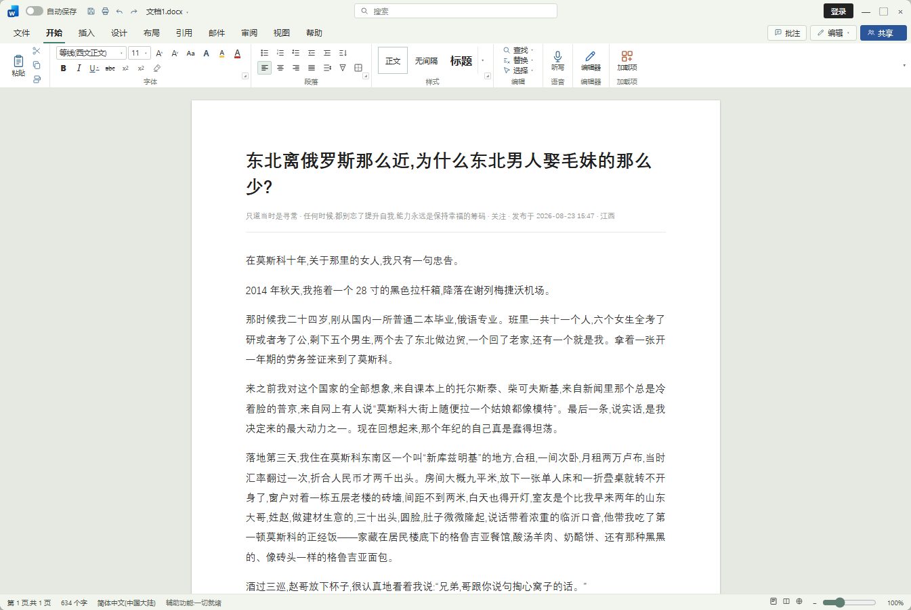

<h1 align="center">知乎 Word 文档模式</h1>

把知乎文章和天涯帖子变成一份 Word 365 文档。

  <a href="https://greasyfork.org/zh-CN/scripts/602452"><strong>Greasy Fork 安装</strong></a>
  ·
  <a href="https://scriptcat.org/zh-CN/script-show-page/8758">脚本猫</a>
  ·
  <a href="https://raw.githubusercontent.com/licc-pai/zhihu-word-mode/main/zhihu-word-mode.user.js">GitHub 直装</a>
  ·
  <a href="#功能">功能</a>
  ·
  <a href="#使用">使用</a>
  ·
  <a href="CONTRIBUTING.md">贡献</a>

  
  

## 为什么做这个

知乎的阅读页信息密度高、视觉上很容易被认出是在刷知乎。这个脚本把正文转成 Word 文档界面，适合在办公环境里低调阅读长文，也适合只想安静看文章、不想被页面其他元素打断的时候。

## 功能

- 支持知乎专栏文章、回答页、问题页，以及天涯帖子页。
- 问题/回答页支持在文档模式内切换回答：标题栏的「回答」按钮打开左侧导航窗格，默认定位到当前正在阅读的回答；切换时正文、作者和评论一起更新。
- 回答窗格支持加载页面之外的更多回答：底部「加载更多回答」按钮，列表滚到底也会自动加载；接口不可用时只保留页面已加载回答并提示原因。
- 天涯帖子页支持整栋楼连续阅读：楼主主帖 + 楼层渲染在同一篇文档中，左侧「楼层」目录可滚动高亮、点击跳转、拖拽调宽。
- 天涯楼层支持只看楼主、引用/子楼层/删除楼层占位，以及「加载更多楼层」（按钮 + 滚到底自动加载）。
- Word 365 风格界面：标题栏、选项卡、功能区、样式组、状态栏。
- 标题栏、选项卡、功能区和状态栏固定，只有白纸区域滚动。
- 进入文档模式后浏览器标签页标题/图标换成 Word，标题栏文件名默认「文档1.docx」，可在设置里修改；退出时自动还原。
- 知乎文末加载评论区：优先直接请求知乎评论接口，失败回退到页面已加载评论；支持“加载更多评论”、嵌套回复、作者/时间/赞数。
- 支持字号、行距、纸张宽度、缩放、深浅主题、打印 / 保存 PDF。
- 点字体组或段落组右下角的 ◢ 打开「字体与版式」设置。
- `Alt + W` 切换文档模式，`Esc` 返回网页；已做知乎 SPA 路由变化检测。

## 安装

1. 先安装 [Tampermonkey](https://www.tampermonkey.net/)。
2. 任选一种方式安装（三者是同一份脚本，装一个就行）：
   - **Greasy Fork**：[知乎 Word 文档模式](https://greasyfork.org/zh-CN/scripts/602452)
   - **脚本猫**：[知乎 Word 文档模式](https://scriptcat.org/zh-CN/script-show-page/8758)
   - **GitHub 直装**：[zhihu-word-mode.user.js](https://raw.githubusercontent.com/licc-pai/zhihu-word-mode/main/zhihu-word-mode.user.js)
3. 篡改猴弹出安装页后点“安装”。
4. 打开知乎文章/回答页，或天涯帖子页，刷新，点右下角“文档模式”或按 `Alt + W`。

手动安装：打开篡改猴面板 → 添加新脚本 → 把 `zhihu-word-mode.user.js` 的全部内容粘进去 → 保存。

## 使用

- 进入/退出：右下角“文档模式”、`Alt + W`、右上角 × 或 `Esc`。
- 切换回答：问题页标题栏的「回答」按钮打开左侧列表；切换后地址栏同步到对应回答，浏览器后退可回到上一个回答；关闭文档模式后停留在当前回答。如果当前是接口加载的回答，关闭时会跳转到该回答页面，重新打开文档模式会回到同一回答（页面未渲染时按 answer id 自动拉取）。
- 加载更多回答：列表底部「加载更多回答」按钮每次加载一页，滚动到列表底部也会自动加载；接口需要登录且可能被风控，失败时保留页面已加载的回答。
- 天涯整帖：打开天涯帖子页 → 文档模式；左侧「楼层」目录可跳转、拖拽调宽，勾选「只看楼主」过滤；底部按钮或滚到底自动加载后续楼层。
- 设置：点字体组或段落组右下角的 ◢，可调字号、行距、纸张宽度、主题、文档名、是否在文末显示评论（仅知乎）。
- 评论：知乎页面默认在正文末尾追加评论区；接口不可用时回退到页面已加载的评论。天涯楼层即正文，不额外渲染评论区。
- 打印：标题栏打印按钮或 `Ctrl/Cmd + P`；打印样式只保留文档正文。

## 隐私

- 脚本只在当前知乎/天涯页面内运行，不向第三方服务器发送内容。
- 知乎评论区和天涯楼层通过对应站点自己的接口加载，使用当前浏览器的登录态；请求只发往 zhihu.com 或 tianya.net。
- 没有统计、埋点或远程配置。

## 兼容性

- 在 Chrome / Edge + Tampermonkey 下开发和测试。
- 知乎的用户名、评论接口等都是未公开的内部结构，知乎改版后可能失效；正文识别和评论都有兜底逻辑，但无法保证长期稳定。
- 天涯 tianya.net 仍是“恢复元气中”的 Vue SPA，读接口可能变化；脚本只做只读请求。
- 当前版本只适配 Word 365 皮肤；多版本皮肤切换在路线图里。

## 已知限制

- 评论区只能拿到接口返回或页面已渲染的部分；被折叠的“查看更多回复”不会自动展开。
- 接口加载需要登录，且可能被知乎风控拦截；失败时只保留页面已加载回答，并在窗格底部提示原因。
- 接口回答的正文和评论都来自知乎自己的接口，失败时会在窗格底部或正文区域提示。
- 知乎评论接口可能需要登录，且可能被风控拦截；失败会回退到页面评论，并在控制台留一条 `[zhihu-word-mode]` 警告。
- 天涯目前只支持帖子页，不支持首页/板块列表转文档。
- 天涯入口页大于第 1 页时只向后加载，不回补前面的楼层；楼层加载不改变地址栏。
- 天涯正文按纯文本处理，不渲染图片；图片帖需要后续版本。
- 天涯约 2000 楼内保持流畅；更长帖子仍可加载，但不做虚拟滚动，可能变慢。
- 引用/子楼层缺少真实 `quotePid` 样本，UI 已按站点语义实现，暂未对真实数据回归。
- 浏览器地址栏的域名仍是 zhihu.com 或 tianya.net；知乎路径会跟随当前回答变化。
- 只模拟界面外观，不是可编辑的 Word 文档，也不生成 .docx 文件。

## 开发

运行时无依赖，直接编辑 `zhihu-word-mode.user.js`。测试使用 dev-only jsdom：`npm install` 后运行 `npm test`；测试方式、提交约定和发布流程见 [CONTRIBUTING.md](CONTRIBUTING.md)。

## 路线图

- [x] Word 365 皮肤
- [x] 标签页 / 文件名伪装
- [x] 文末评论（接口优先 + 页面兜底）
- [x] 天涯整帖阅读（楼层目录 / 只看楼主 / 加载更多）
- [ ] 多套 Word 版本皮肤切换（2003 / 2007 / 2010 / 2013 / 2019…）
- [ ] 更多站点与展示皮肤（扩展落地时再评估仓库改名）
- [ ] 更稳的正文 / 评论选择器

## 免责声明

- 本项目与知乎、Microsoft 均无关联。
- 界面中的 Word 图标与“Word”名称为 Microsoft Corporation 的商标，仅用于界面样式模拟。
- 请遵守知乎的服务条款和所在单位的规定；脚本按“现状”提供，不保证可用性。

## License

[MIT](LICENSE)

---

**English**: A Tampermonkey userscript that renders Zhihu articles/answers and Tianya threads as a Word 365-style document. It fixes the Word chrome while only the page scrolls, disguises the browser tab as a Word document, and can append comments at the end of the article. Tianya threads are read continuously with a floor table of contents, an only-poster filter, and load-more pagination. Built with vanilla JavaScript, no runtime dependencies, and no third-party requests.
